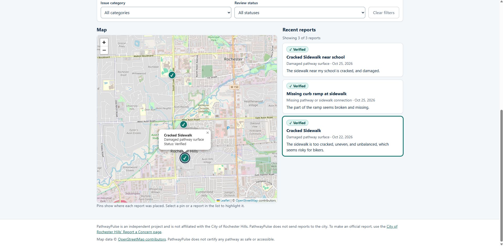
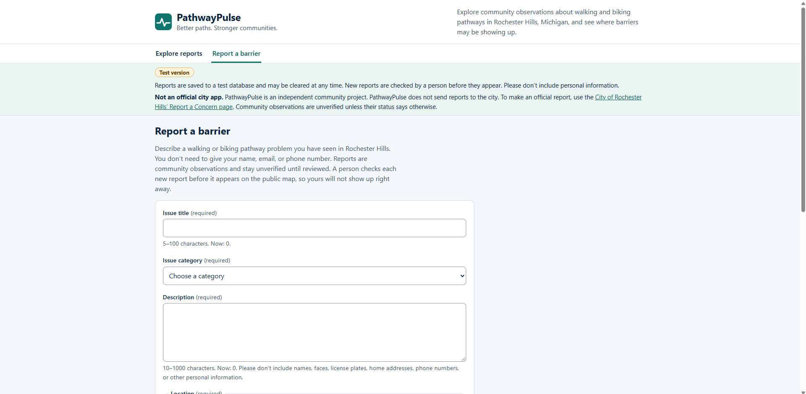
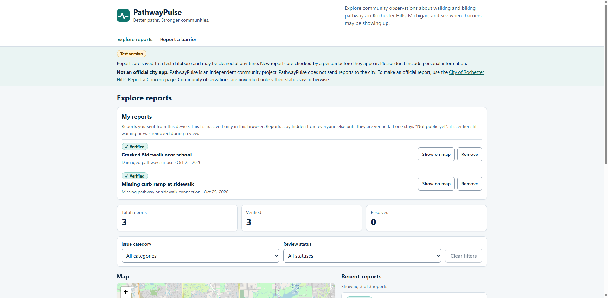

# PathwayPulse

**Better paths. Stronger communities.**

PathwayPulse is a community-powered web app for exploring and reporting walking and biking pathway barriers in Rochester Hills, Michigan. It was built for the Congressional App Challenge 2026.

> **PathwayPulse is an independent student project. It is not an official City of Rochester Hills service.** Submitting a report here does **not** send it to the city. To make an official report, use the city's own [Report a Concern](https://rochesterhills.maps.arcgis.com/apps/instant/reporter/index.html?appid=fa2a4da97b254606a231c14d7647b79b) page.

## Try it

- **Live app:** <https://pathwaypulse-eight.vercel.app>
- This is a **test version**. Reports are saved to a test database and may be cleared at any time. Please don't include personal information.
- The server runs on a free hosting plan and goes to sleep when idle. The first request after a quiet period can take up to about a minute. The app tells you when this is happening.







*The screenshots show sample reports on the test version.*

## The problem

Rochester Hills already has a pathway network and public pathway information. PathwayPulse explores whether residents would benefit from an easier way to document specific barriers, such as:

- damaged pathway surfaces
- blocked pathways
- accessibility barriers
- missing pathway or sidewalk connections

These are problems to investigate, not claims about how common they are. PathwayPulse is meant to complement official resources, not replace them. It never labels a pathway "safe" or "accessible": a map with no reports on a route does not mean the route has no barriers.

**Who it is for:** residents, students who walk or bike, people with mobility needs, and community members or organizers who want to understand recurring concerns.

## What it does

- **Explore** community reports on an interactive map, with a list of recent reports, counts, and filters by issue category and review status.
- **Report a barrier** with a title, category, description, and a location picked on the map. No name, email, or phone number is asked for.
- **My reports:** reports you submit are remembered on your own device, so you can see whether yours is still waiting, or has been verified, without anyone else seeing it.
- **Review before publishing:** every new report starts as *Pending Review* and stays hidden from the public list until a person verifies it.
- **Moderator page:** the project team unlocks a token-protected page at `#/moderate` to verify or delete waiting reports. Automatic screening flags reports that contain an email address, phone number, link, repeated characters, or mostly capital letters, so a person knows what to check carefully. The screening never approves or deletes anything. A person makes every decision.
- **Clear states** for loading, empty results, errors, a sleeping server, and slow or timed-out requests.

## How it works

```
Browser (React app on Vercel)
        |  HTTPS
        v
FastAPI server (Render)  -->  Supabase PostgreSQL
```

1. A visitor submits a report in the browser.
2. The FastAPI server checks it (see "Protections" below) and saves it as **Pending Review**.
3. A moderator opens the moderator page, reads the report (with any automatic warnings), and chooses **Verify** or **Reject**. Verify changes the status to **Verified**. Reject deletes the report.
4. Only then does it appear on the public map and list.

The browser never talks to the database directly. The database's public access is switched off, and only the server, using a secret key kept in environment variables, can read and write reports.

### Protections

- **Server-side validation:** length limits, an allowed category list, and coordinates that must fall inside the Rochester Hills area. Unknown fields are rejected, and a visitor cannot choose a report's status or id.
- **Database rules as a second lock:** the same limits are enforced by CHECK constraints, and Row Level Security is on with no public policies.
- **CORS** is limited to the real frontend address.
- **Rate limit:** at most 5 submissions per hour from one client address. It is kept in the server's memory, so it resets whenever the server restarts. It stops casual spam, not a determined attacker.
- **Duplicate guard:** if an identical title and location was saved in the last 10 minutes, the server returns that report instead of saving another one. This protects against retries after a timeout.
- **Safe text:** reports are displayed as plain text, never as HTML.

## Project status

| Area | Status |
| --- | --- |
| Explore page: map, filters, counts, report list | Working |
| Report form with map location picker | Working |
| FastAPI backend (validation, list and create reports) | Working |
| Supabase database with security setup | Working (`supabase/schema.sql`) |
| Deployment (Vercel, Render, Supabase) | Live test deployment |
| Reports hidden until reviewed | Working |
| Rate limiting and duplicate guard | Working (basic, in memory) |
| Moderator page (verify or reject, token-protected) | Working |
| Rule-based screening that flags reports for a person to check | Working (advisory only) |
| Other status changes (Submitted to Agency, Resolved) | Manual, in the Supabase dashboard |
| Accessibility basics: skip link, labeled controls, visible keyboard focus, keyboard-pannable map | Working, being refined |
| Photo uploads | Not built |
| Reporting inappropriate content | Not built |

## Tech stack

- **Frontend:** React, Vite, JavaScript, CSS
- **Map:** Leaflet and react-leaflet with OpenStreetMap tiles
- **Backend:** Python 3.13 and FastAPI
- **Database:** Supabase PostgreSQL
- **Hosting:** Vercel (frontend), Render (API), Supabase (database)

## Run it locally

You need Node.js (a current LTS release; developed on Node 24) and Python 3.13.

### Frontend only, with sample data (no backend needed)

```bash
cd frontend
npm install
cp .env.example .env.local     # Windows PowerShell: Copy-Item .env.example .env.local
# edit .env.local and set VITE_DATA_SOURCE=sample
npm run dev
```

Open the address Vite prints, usually <http://localhost:5173>. A "Sample data" badge appears and every report is labeled as a made-up sample. Sample data is never presented as real community data.

### Full app (frontend + backend + your own Supabase project)

1. **Database.** Create a free project at [supabase.com](https://supabase.com). In the dashboard open *SQL Editor*, paste the contents of `supabase/schema.sql`, and run it. See [docs/database.md](docs/database.md) for what it sets up.
2. **Backend.** From the repo root:

   ```bash
   cd backend
   python -m venv .venv
   # Windows PowerShell:  .venv\Scripts\Activate.ps1
   # macOS / Linux:       source .venv/bin/activate
   pip install -r requirements.txt
   cp .env.example .env      # Windows PowerShell: Copy-Item .env.example .env
   ```

   Edit `backend/.env` and fill in `SUPABASE_URL` and `SUPABASE_SERVICE_KEY` (the project's secret/service-role key, from *Project Settings, API*). **Never commit this file or share the key.** Then start the server:

   ```bash
   uvicorn app.main:app --reload
   ```

   The API runs at <http://127.0.0.1:8000>, and interactive API docs are at <http://127.0.0.1:8000/docs>.
3. **Frontend.** In a second terminal, run `npm install` and `npm run dev` in `frontend/`. With `VITE_DATA_SOURCE=api` (the default) it talks to the backend at `http://localhost:8000`.
4. **Approve a report.** New reports are *Pending Review* and hidden. Set `MODERATOR_TOKEN` in `backend/.env` (any long random string), restart the backend, open <http://localhost:5173/#/moderate>, enter the token, and choose Verify. (You can also change a row's `status` to `Verified` in the Supabase Table Editor.)

Other frontend commands: `npm run build` (production build), `npm run preview`, `npm run lint`.

## Sample data and test views

With `VITE_DATA_SOURCE=sample` the app reads made-up reports from `frontend/src/data/sampleReports.js`. These URL switches work in both modes and show the other states:

- `/?demo=error` shows the "couldn't load reports" state
- `/?demo=empty` shows the "no reports yet" state
- `/?demo=slow` makes requests take about 6 seconds, to show the "test server is waking up" message
- `/?demo=timeout` shows that message, then the "server didn't respond in time" state with a Retry button
- `/?demo=ratelimit` makes submitting a report fail like the server's "too many reports" (HTTP 429) answer

## How the code is organized

```
backend/    Python / FastAPI API
  app/main.py        routes, CORS, rate-limit and duplicate checks
  app/models.py      the rules a report must follow (Pydantic)
  app/db.py          all Supabase reads and writes
  app/ratelimit.py   the in-memory rate limiter
frontend/   React + Vite app
  src/api/reports.js      the only file that fetches data
  src/components/         header, map, filters, report cards, counts, notices
  src/pages/              Explore page and Report form page
  src/data/               sample reports
  src/constants.js        categories and statuses shared with the backend
supabase/   schema.sql, the database setup
docs/       database notes, deployment notes, official reporting links
```

### Data model

Each report has: `id`, `title`, `description`, `category`, `latitude`, `longitude`, `status`, `created_at`, `photo_path` (optional, unused), and `reviewed_at` (optional).

- **Categories:** `damaged_path`, `blocked_path`, `accessibility_barrier`, `missing_connection`, `other`
- **Statuses:** Pending Review, Verified, Submitted to Agency, Resolved

New public reports always start as Pending Review, and only a moderator (with the secret moderator token) or someone with database access can change a status. "Submitted to Agency" is meant to be used only after a report was actually submitted, and "Resolved" only with credible evidence.

## Deploying

PathwayPulse is deployed with **Vercel** (frontend), **Render** (Python API), and **Supabase** (database). Set the variables below in each host's dashboard. **Never commit real values.** More detail is in [docs/deployment-requirements.md](docs/deployment-requirements.md).

### Render (backend API)

| Variable | What to put there | Notes |
| --- | --- | --- |
| `SUPABASE_URL` | Your Supabase project URL | Supabase dashboard, Project Settings, API |
| `SUPABASE_SERVICE_KEY` | Your Supabase **secret / service_role** key | **Secret.** Full database access. Server only; never in the frontend |
| `MODERATOR_TOKEN` | A long random secret string | **Secret.** Unlocks the moderator endpoints. If it is missing, the moderator endpoints stay locked. Never put it in the frontend |
| `ALLOWED_ORIGINS` | The frontend's address, e.g. `https://YOUR-APP.vercel.app` | Several addresses separated by commas, **no spaces and no trailing slash** |
| `PYTHON_VERSION` | A full Python version, e.g. `3.13.14` | Render needs the full version number |

Service settings: root directory `backend`, build command `pip install -r requirements.txt`, start command `uvicorn app.main:app --host 0.0.0.0 --port $PORT`, health check path `/health`.

### Vercel (frontend)

| Variable | What to put there | Notes |
| --- | --- | --- |
| `VITE_API_URL` | The public address of the Render service | **Public**: it is baked into the site at build time, so redeploy after changing it |

Project settings: root directory `frontend`, build command `npm run build`, output directory `dist`. Leave `VITE_DATA_SOURCE` unset so the app uses the real API.

### Order of setup

1. Deploy the backend on Render and copy its address.
2. Put that address in `VITE_API_URL` on Vercel and deploy the frontend.
3. Put the Vercel address in `ALLOWED_ORIGINS` on Render and redeploy the backend. Until you do, the browser blocks the frontend from calling the API.

### Free-tier "waking up" delay

Render's free plan puts the API to sleep after about 15 minutes without traffic, and the first request afterwards can take around a minute. The app handles this: after about 4 seconds it shows "The test server is waking up. This can take up to a minute." and keeps waiting, then stops after about 75 seconds with a Retry button. If submitting a report times out, the form says it cannot tell whether the report was saved and asks people to check before sending it again.

## Privacy and accuracy

- Contributors are not asked for a name, email, or phone number, and the database has no column for them.
- To power the "My reports" list, your browser remembers the id, title, category and date of reports you submit. This stays on your device only (browser storage), is never sent anywhere, and can be removed with the Remove button.
- Descriptions should not include faces, license plates, home addresses, or other personal information.
- Community observations are unverified unless their status says otherwise.
- Like any web host, the hosting services may keep ordinary server logs that include visitors' network addresses.
- Map data is from [OpenStreetMap contributors](https://www.openstreetmap.org/copyright).

## Known limitations

- This is a test version: reports are saved to a test database and may be cleared at any time.
- Moderation is done by people. The moderator page uses one shared secret token, not individual accounts, and it does not limit repeated wrong guesses yet. The automatic screening only matches simple patterns (for example, it will not catch an email written as "bob at example dot com"). There is no "report inappropriate content" button yet.
- The rate limiter lives in the server's memory and resets when the server restarts. The duplicate guard only catches identical reports, and two simultaneous requests could still both be saved.
- The server's free hosting plan sleeps when idle, so the first visit can be slow.
- Photo uploads are not supported.
- Some libraries the server depends on are not pinned to exact versions, so a rebuild could pick up newer ones.
- There is no automated test suite. The app was checked by hand, including a small test with volunteers.

## How this was built

PathwayPulse was built by Muhil with help from a friend, Khazar, and an AI assistant.

- **Muhil** wrote the Python backend: the FastAPI server, its connection to the Supabase database, reading and saving reports, the moderator endpoints, and the rule-based screening. He directed the project, tested each change himself, and made the decisions about what to ship.
- **Khazar** researched the mapping side of the project, tested the app throughout, and gave feedback based on what he observed. His feedback led to real changes, including the "Other" category, the "My reports" list, a clearer explanation of the review step, and the moderator page. He also agreed to open-sourcing the project.
- **Claude** (an AI assistant made by Anthropic) built the React and JavaScript frontend, the database setup scripts, the deployment configuration and the documentation. It also explained concepts and reviewed Muhil's backend code as he wrote it.

## Contributing and contact

This is a student project. Ideas and bug reports are welcome through GitHub Issues.

## License

This project is open source under the [MIT License](LICENSE). The "PathwayPulse" name and the City of Rochester Hills' official services are not covered by it, and PathwayPulse is not affiliated with the city.
